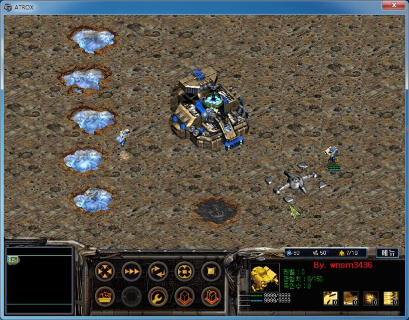
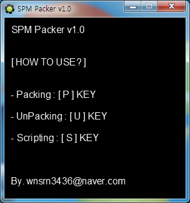
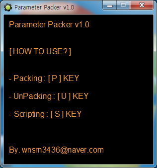

# Atrox Parameter Tools

[한국어](README.ko.md)

Three tools that extract the parameters stored in an Atrox (Joymax) map (unit stats, upgrades, special abilities) as text for editing, and let a normal game use the edited values.

| Tool | What it does |
|---|---|
| SPM Packer | Extracts the LHA compressed map data inside a map file (`.spm`) into a `.mapdata` file and puts the edited one back |
| Parameter Packer | Extracts the parameters of a `.mapdata` into eight txt files, one per player, and writes the edited txt files back |
| Parameter Patch | Patches the game executable so a normal game also reads the parameters and unit placement of the map |

The map file structure is in [docs/spm-format.md](docs/spm-format.md), the parameter structure in [docs/parameter-format.md](docs/parameter-format.md), and the bytes changed by Parameter Patch in [docs/parameter-patch.md](docs/parameter-patch.md).

**Compatible version**: Atrox v1.10 build 1

<p>
  
</p>
<p>
  
  
</p>


## How to use

Releases has three archives with one tool in each. Use them in order.

**1. Extracting the map data (SPM Packer)**

SPM Packer handles the LHA compression with [LHa 1.14i](https://gnuwin32.sourceforge.net/packages/lha.htm) from GnuWin32. Download `lha.exe` from there, rename it to `lha.ex_`, and put it next to `spm-packer.exe`, or the tool will not start.

| Key | Action |
|---|---|
| U | Pick an `.spm` and `<file name>.mapdata` is created in the same folder |
| P | Pick a `.mapdata` and then an `.spm`, and the compressed part of the `.spm` is replaced with the newly compressed `.mapdata` |
| S | Pick a script txt in the format below to process several maps at once |

```
U|C:\maps\mymap.spm
P|C:\maps\mymap.mapdata|C:\maps\mymap.spm
```

Maps whose map data is not compressed, such as the maps that come with the game, give `SPM Header Error!`. Open one in the map editor and save it under a new name, and it is stored compressed and can be extracted.

**2. Editing the parameters (Parameter Packer)**

| Key | Action |
|---|---|
| U | Pick a `.mapdata` and enter the name of Player 1's Engineer (the default is `엔지니어`, Korean for Engineer), and eight files, `<file name>_parameter1.txt` through `_parameter8.txt`, are created |
| P | Pick `_parameter1.txt` and a `.mapdata` and enter the Engineer name, and all eight are written into the `.mapdata` |
| S | Process several at once with a script txt in the format below |

```
U|C:\maps\mymap.mapdata|엔지니어
P|C:\maps\mymap_parameter1.txt|C:\maps\mymap.mapdata|엔지니어
```

The tool uses the Engineer name to find where the parameters are, so if the name was changed in the map, enter the new name. Writing the values back needs all eight txt files. To give every player the same values, edit one, copy it, and change only the number.

To keep the values from returning to the Atrox defaults when the map is opened and saved again in the map editor, set the default setting of each entry to 0. Before using a map made with the old map editor, open Settings > Parameters in the map editor, press OK, and save the map. The duration and step time of special abilities are floats stored as integers with the same bits (30.0 is `1106247680`).

When you are done, use the P key in SPM Packer to put the `.mapdata` back into the map.

**3. Applying it to the game (Parameter Patch)**

A file dialog opens on launch. Pick the UPX-unpacked `atrox.exe`, and the tool patches it in place and shows `Success!`. It makes no backup, so copy the file first. The retail `atrox.exe` is packed with UPX, so patch the file after unpacking it with `upx -d`.

Whatever game type is chosen in the room, the patched game runs as a normal game that reads the map's parameters and unit placement. Use an unpatched executable to open the scenario maps that come with the game. For multiplayer, everyone must use the same map and the patched executable.


## How it works

**SPM Packer skips the header and handles only the LHA part.** A map file has a 1130-byte fixed header, then length-prefixed victory condition, defeat condition, and briefing strings, and from there to the end of the file an LHA archive using the `-lh5-` method. The tool follows the string lengths to find where the archive starts. To extract, it cuts everything from there into an `.lzh` file and unpacks it with `lha.ex_ x`. To pack, it compresses the data again with `lha.ex_ a -1` and appends the result to the part of the original map that comes before the old archive.

```gml
lh5_start = file_bin_position(spm_file)
file_bin_seek(spm_file, lh5_start+2)
lh5 = file_bin_read_char(spm_file, 5)
if(lh5=="-lh5-")
{
    ...
    execute_program("lha.ex_", "x -i -w="+chr(34)+string_copy(extract_path, 1, string_length(extract_path)-1)+chr(34)+" "+chr(34)+lh5_path+chr(34), true)
```

**Parameter Packer finds the position by the Engineer name.** Without parsing the map data in front of the parameters, it reads the MAPDATA byte by byte from the start, finds the name of Player 1's Engineer, and takes the position 8 bytes before it as the start. After that each player has 123 units (0xC2 bytes each), 58 upgrades (0x20 bytes each), and 32 special abilities (0x24 bytes each) at fixed sizes, so the tool reads integers, short integers, and fixed-length strings in a set order, writes them to txt, and writes them back in the same order.

**Parameter Patch overwrites seven spots in the executable.** The three spots that set the game type become `mov esi, 4`, so the game type is always the use map value (4). The player setup block that type 4 used to run is skipped, and the starting building block it used to skip now runs. The two blocks that extract a map from `atrox.pak` to a temporary file and open it are always skipped as well. The source has the offsets and bytes in decimal.

```gml
file_bin_seek(atrox, 500538)
file_bin_write_byte(atrox, 190)
file_bin_write_byte(atrox, 4)
file_bin_write_byte(atrox, 0)
file_bin_write_byte(atrox, 0)
file_bin_write_byte(atrox, 0)
file_bin_write_byte(atrox, 144)
```

This part writes `BE 04 00 00 00 90` (`mov esi, 4` and `nop`) at `0x7A33A` (500538).


## Files

| Path | Contents |
|---|---|
| `source/parameter-patch/parameter-patch.gmk` | Original Parameter Patch project file |
| `source/spm-packer/spm-packer.gmk` | Original SPM Packer project file |
| `source/parameter-packer/parameter-packer.gmk` | Original Parameter Packer project file |
| `source/*/split/` | Text tree produced by GmkSplitter |
| `docs/spm-format.md` | Map file (SPM) structure |
| `docs/parameter-format.md` | Parameter structure and txt format |
| `docs/parameter-patch.md` | Bytes changed by Parameter Patch and assembly notes |
| `docs/screenshots/` | Screenshots |
| Releases | Executable and usage notes for each tool |


## Credits

- The `lha.ex_` that SPM Packer calls is `lha.exe` from the GnuWin32 build of LHa 1.14i. LHa for UNIX was written by Masaru Oki, modified by Nobutaka Watazaki and Tsugio Okamoto, and turned into an autoconf version by Koji Arai. The LHa license does not allow distributing the executable without its source, so download it directly from GnuWin32.
- The GM Windows Dialogs extension used for message boxes was made by Mark Overmars and shipped with GameMaker 8.


## License

zlib. See [LICENSE](LICENSE). Bundled libraries made by other people keep their own licenses.
